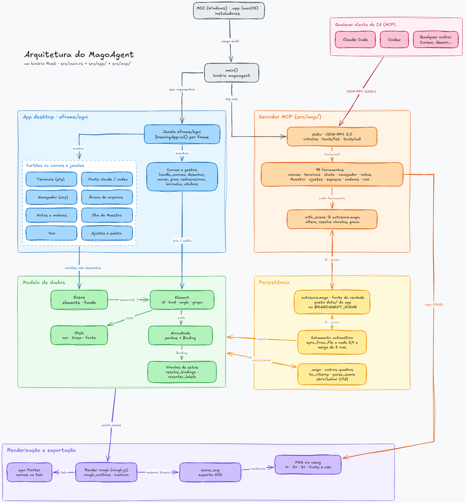

<p align="center">

</p>

# MagoAgent

**Um canvas infinito para orquestrar agentes de IA.** Cada agente (Claude Code, Codex ou qualquer CLI) roda
num terminal de verdade em cima de um quadro sem fim. Você liga os agentes uns aos outros, e às
notas, páginas e projetos de que eles precisam, puxando uma corda. Eles enxergam o que está ligado,
conversam entre si, recrutam ajudantes e avisam quando precisam de você.

A **Luna** é a assistente do MagoAgent. Você conversa com ela pelo chat ou por voz, e ela rege o time:
recruta agentes, liga as cordas, desenha no canvas e conta quem precisa de você. Ela mora na ilha, no
topo da tela. O app é nativo em Rust (`eframe/egui`), sem Electron, e roda em macOS, Windows e Linux.

## Arquitetura



## O que faz

- **Luna:** a assistente. Converse com ela no chat ou numa chamada de voz. Na chamada, dizer "Ok Mago, …" chama a Luna com o pedido. Ela usa as ferramentas do app (o MCP) para montar e dirigir o time de agentes, e guarda o que aprende sobre como você trabalha (Ajustes › Dados › Memória da Luna).
- **Canvas:** formas com traço à mão, setas presas às formas, texto, imagens, camadas, minimapa e exportação PNG/SVG. É onde você desenha o plano e o agente desenha a resposta.
- **Terminais (agentes):** shells de verdade (zsh, bash, PowerShell) com cores, acentos, Claude Code ou Codex rodando dentro. Cada terminal tem nome, cor e pasta próprios.
- **Conexões:** uma corda entre duas coisas do canvas diz quem fala com quem. Pelo terminal, o `magoagent` lista conexões, manda prompts, lê telas, controla portais e monta equipes.
- **Notas adesivas:** Markdown em pilha; notas ligadas formam correntes acessíveis por clique.
- **Portais:** navegador (WebKit no macOS, WebView2 no Windows) sobre o canvas. O agente circula trechos da página e recebe coordenadas, elementos e comentários.
- **Árvore de arquivos:** pasta virada card com git (ramos, diff, autor), painel de código com realce e Localizar. Selecione linhas e use **Comentar para a Luna** (Ctrl+Alt+M) para mandar um pedido sobre aquele trecho.
- **Chamada de voz:** janela pequena por cima de tudo (microfone, alto-falante, orbe). A voz pode ser do Codex (tempo real), da API da OpenAI ou de um servidor VoiceStudio seu.
- **Ilha da Luna:** pílula fixa no topo da tela, por cima de todas as janelas, com a Luna, o estado de cada agente, as perguntas pendentes, o chat e as abas do GitHub e do Spotify.


## Instalar e executar

```sh
cargo run --release       # roda direto
cargo test                # testes (gestos, arquivos, exportação, MCP, ponte)
./build-macos-app.sh      # macOS: gera e abre o MagoAgent.app
```

- **Windows:** use o `MagoAgent-<versão>.msi` da release do GitHub. Instala em `C:\Program Files\MagoAgent`. Ajustes › Sobre › Atualizar baixa o MSI novo. Dados ficam em `data/` dentro da pasta de instalação.
- **Linux (Debian/Ubuntu):** pelo repositório apt do projeto ([docs/apt.md](docs/apt.md)), ou o `.deb` da release; atualiza pelo apt. Adicione o repositório uma vez e instale:

  ```sh
  curl -fsSL https://edsuuu.github.io/magoagent/apt/magoagent.gpg | sudo tee /usr/share/keyrings/magoagent.gpg > /dev/null
  echo "deb [arch=amd64 signed-by=/usr/share/keyrings/magoagent.gpg] https://edsuuu.github.io/magoagent/apt ./" | sudo tee /etc/apt/sources.list.d/magoagent.list
  sudo apt update && sudo apt install magoagent
  ```

- **macOS e Linux:** dados em `~/Library/Application Support/MagoAgent/` (macOS) ou `~/.local/share/magoagent/` (Linux).
- **Linux:** o diálogo de arquivos usa xdg-desktop-portal; portais ainda não abrem no Linux.
- **Primeira vez:** a Luna apresenta o app e pede o primeiro espaço de trabalho (um projeto: um quadro e uma pasta).
- **Começar do zero:** Ajustes › Dados › Limpar todos os dados apaga os desenhos, os chats, os ajustes e as senhas guardadas, e abre o app como na primeira vez. Pergunta antes e não tem volta.

## A ilha da Luna

A Luna mora numa pílula flutuante no topo da tela (`Prefs.island`), por cima de todas as janelas. Fechada, a ilha mostra a Luna e uma chaminha por agente, com o estado de cada um em tempo real: quem trabalha, quem espera aprovação, quem está parado. Os olhos dela seguem o cursor e, com a música tocando, ela dança (Ajustes › Integrações). Aberta, a ilha tem abas:

- **Início:** o resumo dos agentes e das integrações, e as perguntas pendentes para responder;
- **Chat atual** e **Conversas:** o chat em uso e os agentes do app;
- **Claude Code:** as sessões de fora do app, com uma mensagem para elas (pelo tmux ou no fim da vez);
- **GitHub:** pull requests com filtros (abertos, mesclados, fechados), o detalhe, a descrição e um comentário;
- **Spotify:** o player com capa, controles e aparelhos, além de Próximas, Playlists, Curtidas e a busca;
- **+:** um chat novo com Claude Code ou Codex (sem terminal) num espaço novo.

O GitHub e o Spotify se ligam em Ajustes › Integrações. A ilha também mostra a chamada de voz (microfone e alto-falante). Dá para arrastá-la para outro lugar ou outro monitor; Ajustes › Geral › Trazer a ilha de volta a põe no lugar padrão.

## O MCP

`magoagent mcp` é um servidor [MCP](https://modelcontextprotocol.io) (stdio, JSON-RPC 2.0). Com ele, qualquer IA:

- lê e desenha no canvas (`get_scene`, `add_elements`, `update_elements`, `delete_elements`, `view`);
- fala com agentes (`ask_agent`, `read_terminal`), lê/escreve notas;
- usa portais (`portal_navigate`, `portal_click`, `portal_fill`);
- monta equipes (`recruit_agent`, `create_portal`, `connect`);
- controla o app (arquivos, janelas, git, abas, ajustes).

É também por ele que a Luna mexe no app. Todas as ferramentas, com os parâmetros, em [docs/mcp.md](docs/mcp.md).

### Configuração

Claude Code:

```sh
claude mcp add magoagent -- /caminho/para/magoagent mcp
```

Codex (`~/.codex/config.toml`):

```toml
[mcp_servers.magoagent]
command = "/caminho/para/magoagent"
args = ["mcp"]
```

Claude Desktop, Cursor e outros:

```json
{ "mcpServers": { "magoagent": { "command": "/caminho/para/magoagent", "args": ["mcp"] } } }
```

## CLI dos agentes (dentro do canvas)

Dentro de qualquer terminal, o `magoagent` já está no PATH:

| Comando | O que faz |
| --- | --- |
| `magoagent list` | conexões deste terminal |
| `magoagent ask <nome> <prompt>` | manda prompt ao agente e espera resposta |
| `magoagent check <nome>` | lê a tela do agente sem enviar nada |
| `magoagent note read/write/create` | gerencia notas ligadas |
| `magoagent portal navigate/text/eval/click/fill` | usa portais ligados |
| `magoagent recruit [comando]` | cria um agente abaixo de você (padrão: claude) |
| `magoagent connect <a> [b]` | liga `<a>` a `<b>` (ou a este terminal) |
| `magoagent notify <texto>` | avisa a pessoa no app e na notificação do sistema |

## Primeiro passo rápido

1. Clone e rode: `cargo run --release`. Na primeira vez, a Luna apresenta o app e pede o primeiro espaço.
2. Abra **Painel de agentes** (Ctrl/⌘+J), inicie um terminal com Claude Code ou Codex.
3. No terminal, rode `magoagent recruit` para criar outro agente ligado ao primeiro.
4. A Ilha da Luna mostra quem está trabalhando. Para dar ordens ao time, fale com a Luna pelo chat ou numa chamada de voz ("Ok Mago, …").

## Compilar do código

```sh
# Formatação
rustfmt --edition 2024 --check $(find src -name "*.rs")

# Lints
cargo clippy --all-targets --release -- -D warnings

# Testes
cargo test --release

# Checar outros alvos
cargo check --release --target x86_64-unknown-linux-gnu
cargo check --release --target x86_64-pc-windows-msvc
cargo check --release --target aarch64-apple-darwin
```

O guia de quem mexe no código (estrutura, fluxo de trabalho e testes) fica no [`AGENTS.md`](AGENTS.md).

## Licenças

As fontes em `assets/` são OFL (`Excalifont-license.txt`, `Assistant-license.txt`). Os ícones em `assets/editor-icons/` são da JetBrains (Apache 2.0; veja `NOTICE`). O código da Árvore de Arquivos usa Inter e JetBrains Mono de uma instalação JetBrains local, quando houver.
