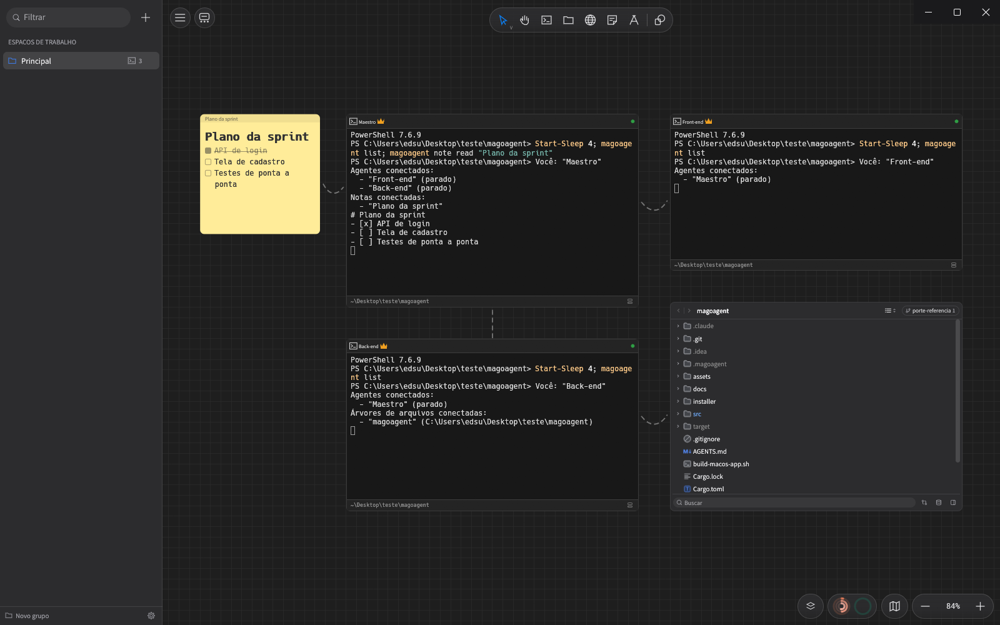
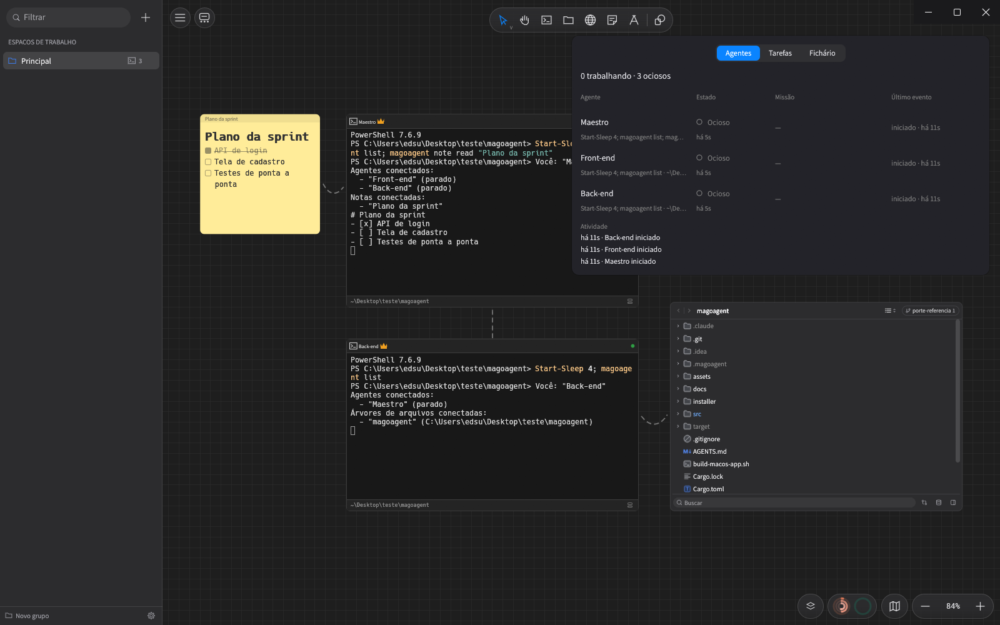
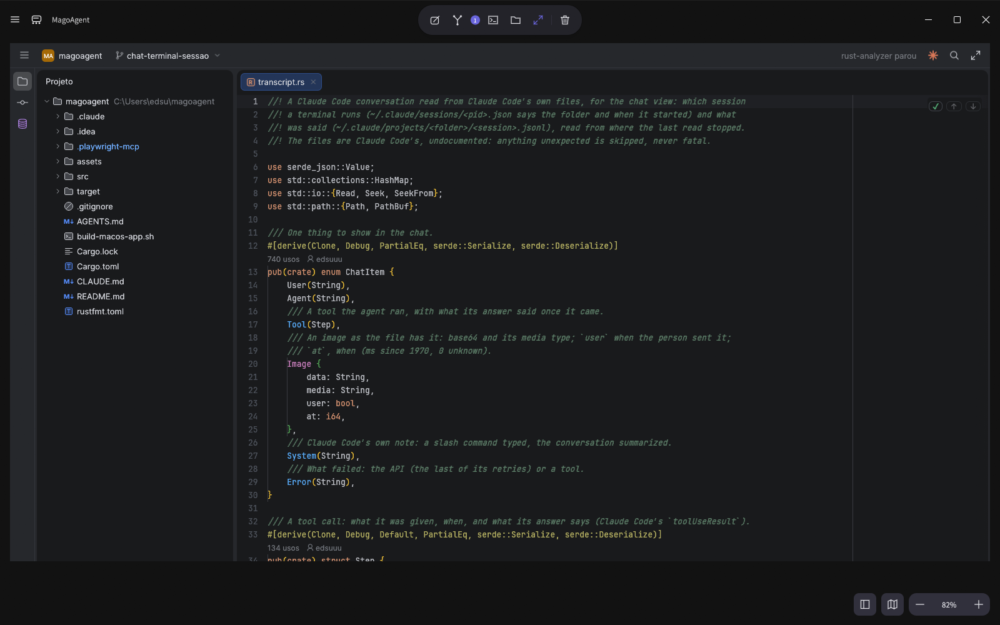

# MagoAgent

**Um canvas para orquestrar agentes de IA.** Cada agente (Claude Code, Codex ou qualquer CLI) roda
num terminal de verdade em cima de um quadro infinito. Você liga os agentes uns aos outros, e às
notas, páginas e projetos de que eles precisam, puxando uma corda. Eles enxergam o que está ligado,
conversam entre si, recrutam ajudantes e avisam quando precisam de você. O app é nativo em Rust
(`eframe/egui`), sem Electron, e roda em macOS, Windows e Linux.



*O Maestro lê o plano da sprint (`magoagent note read`) e vê quem está ligado a ele
(`magoagent list`). O Front-end lê a página do portal ligado a ele (`magoagent portal text`), e o
Back-end enxerga o IDE do projeto.*

## A ideia

Um agente sozinho num terminal não sabe dos outros. No MagoAgent o canvas é o mapa da equipe:

- **Agentes:** cada terminal é um agente com nome, pasta, comando e cor. O shell é de verdade
  (zsh, bash, PowerShell), com cores, acentos e o Claude Code ou o Codex rodando dentro.
- **Conexões:** uma corda entre duas coisas do canvas diz quem fala com quem. Dentro do terminal,
  o agente usa a CLI `magoagent` (ou as mesmas ferramentas pelo MCP) para:
  - mandar um prompt a outro agente e esperar a resposta;
  - ler a tela de outro agente;
  - ler e escrever notas;
  - navegar e clicar em páginas.
- **Maestro:** um agente Maestro monta o próprio time. Ele recruta agentes novos abaixo dele, abre
  portais, liga as peças e manda notificações para você.
- **Você no comando:** o painel de agentes mostra quem trabalha, quem está parado e quem espera uma
  aprovação. O chat mostra a conversa de cada um, e a chamada de voz deixa você dar ordens falando.



## O que tem no canvas

- **Terminais (agentes):**
  - atalhos para Claude Code, Codex e Shell;
  - compositor de prompts e barra de contexto (editar, conectar, reiniciar, ampliar, apagar);
  - clique duplo no título amplia; "Iniciar no modo de chat" abre a conversa ao clicar;
  - "Descarregar" encerra o shell e guarda o lugar.
- **Notas adesivas:** o plano, a especificação, o checklist, tudo com Markdown. Notas ligadas a
  notas formam uma corrente: quem alcança a primeira alcança todas.
- **Portais:** um navegador com abas sobre o canvas (WebKit no macOS, WebView2 no Windows; no Linux
  ainda não abre). Quando o agente clica ou digita na página, o cursor dele aparece lá com o nome
  do terminal. Com o lápis da barra você circula algo na página, escreve o que mudar, e o agente
  ligado recebe o endereço, a região, os elementos e o comentário.
- **IDE:** uma pasta vira um card com a árvore e a branch, e o clique duplo abre o editor ampliado.
  - **Edição:** abas, realce de sintaxe, localizar e pesquisar em tudo (Shift duas vezes).
  - **Git:** diff, commit, push e pull.
  - **Linguagem:** com um servidor de linguagem instalado, ir para a declaração, usos e documentação.
  - **Banco de dados:** os SQLite do projeto num painel próprio.
  - **Claude Code:** um terminal ligado ao IDE conecta o Claude Code a ele. As mudanças que ele
    propõe abrem como diff para aceitar, rejeitar ou comentar; o comentário volta ao agente com o
    arquivo e as linhas.
- **Quadro branco:** formas com traço à mão, setas presas às formas, texto, imagens, quadros,
  desenho livre, bloqueio, camadas, minimapa e exportação PNG/SVG. É onde você desenha o plano e o
  agente desenha a resposta.



## Três telas e a voz

| Atalho | Tela |
| --- | --- |
| Ctrl/⌘+1 | **Chat:** a conversa do agente como num app de chat (Markdown, código, ferramentas usadas, imagens). Também abre chats diretos com o Claude Code ou o Codex, sem terminal. |
| Ctrl/⌘+2 | **Canvas:** o mapa da equipe. |
| Ctrl/⌘+3 | **IDE:** o projeto aberto, ampliado. |
| Ctrl/⌘+J | **Painel de agentes:** estado de cada um. Ctrl/⌘+Shift+A vai ao próximo que precisa de você. |

**Chamada de voz:** a chamada fica numa janela pequena por cima de tudo, que você arrasta para onde
quiser. Nela ficam o microfone, os alto-falantes e o mascote do agente (ou o orbe), que mostra se
ele está ouvindo, pensando ou falando; o lápis abre o chat num popup. A voz pode ser do Codex (tempo
real, com o login do ChatGPT), da API da OpenAI ou local (whisper.cpp para ouvir, Piper para falar).
O que você pede por voz vira ação no app: abrir uma pasta, um chat, um portal ou um arquivo.

## A CLI dos agentes

Dentro de qualquer terminal do canvas, o `magoagent` já está no PATH:

```text
magoagent list                         o que está conectado a este terminal
magoagent ask <nome> <prompt>          manda o prompt ao agente e espera ele terminar
magoagent check <nome>                 lê a tela do agente sem mandar nada
magoagent note read|write|create       lê, troca ou cria notas ligadas
magoagent portal navigate|text|eval|click|fill   usa um portal ligado
magoagent recruit [comando]            cria um agente abaixo de você, já ligado (padrão: claude)
magoagent portal create <url> [nome]   abre um portal à sua direita, ligado a você
magoagent connect <a> [b]              liga você a <a>, ou <a> a <b>
magoagent notify <texto>               avisa a pessoa (no app e numa notificação do sistema)
```

## MCP: qualquer IA usa o canvas

`magoagent mcp` é um servidor [MCP](https://modelcontextprotocol.io) (stdio). Com ele a IA:

- lê e desenha no canvas, e você vê o desenho aparecer traço a traço com o cursor e o nome do
  agente (Ctrl/⌘+Z desfaz);
- fala com os outros agentes: `list_agents`, `ask_agent`, `read_terminal`, `read_note`,
  `write_note`, `create_note`;
- usa os portais: `portal_navigate`, `portal_read`, `portal_eval`, `portal_click`, `portal_fill`;
- monta o time: `recruit_agent`, `create_portal`, `connect`, `notify`;
- faz tudo o que você faz no app: abrir IDE, arquivos, chats e janelas, git, abas, ajustes e áreas.

As ferramentas de desenho são `get_scene`, `add_elements`, `update_elements`, `delete_elements`,
`clear_canvas`, `view` (devolve um PNG para a IA conferir), `save_file`, `open_file` e
`set_background`. Elas funcionam com o app fechado. As dos agentes e as do app falam com o app
aberto por uma ponte local com token.

O comando do servidor é o próprio programa com o argumento `mcp`.

Claude Code:

```sh
claude mcp add magoagent -- /caminho/para/magoagent mcp
```

Codex (`~/.codex/config.toml`):

```toml
[mcp_servers.magoagent]
command = "/caminho/para/magoagent"
args = ["mcp"]
```

Claude Desktop, Cursor e outros (`mcpServers` no JSON de configuração):

```json
{ "mcpServers": { "magoagent": { "command": "/caminho/para/magoagent", "args": ["mcp"] } } }
```

## Instalar e executar

```sh
cargo run --release       # roda direto, em qualquer sistema
cargo test                # testes (gestos, arquivos, exportação, MCP, ponte dos agentes)
./build-macos-app.sh      # macOS: gera e abre o MagoAgent.app
```

- **Windows:** o instalador é o `MagoAgent-<versão>.msi` da release do GitHub. Ele pede
  administrador, instala em `C:\Program Files\MagoAgent`, cria o atalho no menu Iniciar e troca a
  versão anterior; Ajustes › Sobre › Atualizar baixa o MSI novo. Os desenhos, chats, preferências e modelos de voz ficam
  em `data/`, dentro da pasta da instalação.
- **macOS e Linux:** antes de instalar, os dados ficam em `~/Library/Application Support/MagoAgent/`
  (macOS) ou `~/.local/share/magoagent/` (Linux).
- **Linux:** o diálogo de arquivos usa o portal do desktop (xdg-desktop-portal).

## Desenvolvimento

O guia de quem mexe no código (estrutura, fluxo de trabalho, testes e convenções) fica no
[`AGENTS.md`](AGENTS.md), o mesmo para pessoas e para os agentes de IA (Codex, Cursor e outros o
leem direto; o `CLAUDE.md` só o importa).

## Licenças

As fontes em `assets/` são OFL; veja `assets/hand-font-license.txt` e
`assets/Assistant-license.txt`. Os ícones em `assets/ide-icons/` são da JetBrains (Apache 2.0);
veja `assets/ide-icons/NOTICE`. O IDE usa Inter e JetBrains Mono de uma instalação JetBrains
local, quando houver.
