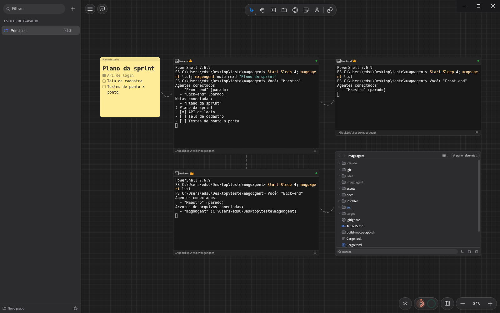

<p align="center">

</p>

<h1 align="center">MagoAgent</h1>

<p align="center">
Um canvas infinito para orquestrar agentes de IA.<br>
Nativo em Rust, para Windows, macOS e Linux.
</p>

<p align="center">
<a href="https://github.com/edsuuu/magoagent/releases/latest"></a>
<a href="https://github.com/edsuuu/magoagent/actions/workflows/ci.yml"></a>
<a href="LICENSE"></a>
</p>

> **Alpha:** o MagoAgent muda rápido e ainda pode quebrar. Guarde uma cópia do que importa.

Cada agente (Claude Code, Codex ou qualquer CLI) roda num terminal ou num chat em cima de um quadro sem fim. Uma corda
entre duas coisas do canvas diz quem fala com quem: os agentes enxergam o que está ligado a eles, conversam entre si,
recrutam ajudantes e avisam quando precisam de você. A **Luna**, a assistente do app, rege o time pelo chat.



## Destaques

- **Canvas:** formas com traço à mão, setas presas às formas, notas em markdown, imagens, minimapa e exportação PNG/SVG.
- **Agentes:** terminais de verdade (zsh, bash, PowerShell) e chats com Claude Code ou Codex, cada um com nome, cor e
  pasta.
- **Conexões:** cordas ligam agentes a notas, navegadores, pastas e outros agentes.
- **Navegador e Árvore de Arquivos:** páginas e projetos (com git) dentro do canvas, ao alcance dos agentes.
- **Ilha da Luna:** uma pílula no topo da tela, por cima de tudo, com o estado de cada agente, as perguntas pendentes e
  o chat.
- **MCP:** qualquer IA desenha no canvas e controla o app ([todas as ferramentas](docs/mcp.md)).

## Instalar

- **Windows:** o `MagoAgent-<versão>.msi` da [última release](https://github.com/edsuuu/magoagent/releases/latest).
  Depois, Ajustes › Sobre › Atualizar traz as versões novas.
- **Linux (Debian/Ubuntu):** pelo repositório apt ([detalhes](docs/apt.md)):

  ```sh
  curl -fsSL https://edsuuu.github.io/magoagent/apt/magoagent.gpg | sudo tee /usr/share/keyrings/magoagent.gpg > /dev/null
  echo "deb [arch=amd64 signed-by=/usr/share/keyrings/magoagent.gpg] https://edsuuu.github.io/magoagent/apt ./" | sudo tee /etc/apt/sources.list.d/magoagent.list
  sudo apt update && sudo apt install magoagent
  ```

- **macOS:** compile e gere o app com `./build-macos-app.sh` (veja o [CONTRIBUTING](CONTRIBUTING.md)).

Na primeira vez, a Luna apresenta o app e pede o primeiro espaço de trabalho (um quadro e uma pasta).

## Usar com outros agentes (MCP)

`magoagent mcp` é um servidor [MCP](https://modelcontextprotocol.io) (stdio). No Claude Code:

```sh
claude mcp add magoagent -- /caminho/para/magoagent mcp
```

No Codex, Claude Desktop, Cursor e outros, use o comando `/caminho/para/magoagent` com o argumento `mcp`. Os chats do
próprio app já recebem o MCP sozinhos.

Dentro dos terminais do canvas, o `magoagent` já está no PATH: `list`, `ask`, `check`, `note`, `portal`, `recruit`,
`connect` e `notify` falam com os agentes e as coisas ligadas ao terminal.

## Arquitetura


## Contribuir

Veja o [CONTRIBUTING](CONTRIBUTING.md). As regras completas do código ficam no [AGENTS.md](AGENTS.md).

## Segurança

Para relatar uma falha, siga o [SECURITY](SECURITY.md). Não abra uma issue pública.

## Licença

[MIT](LICENSE). As fontes em `assets/` são OFL (`Excalifont-license.txt`, `Assistant-license.txt`), e os ícones em
`assets/editor-icons/` são da JetBrains, sob Apache 2.0 (veja o `NOTICE` da pasta).
